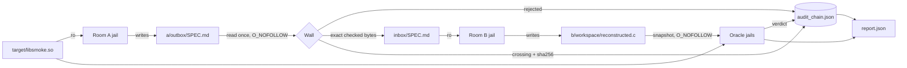
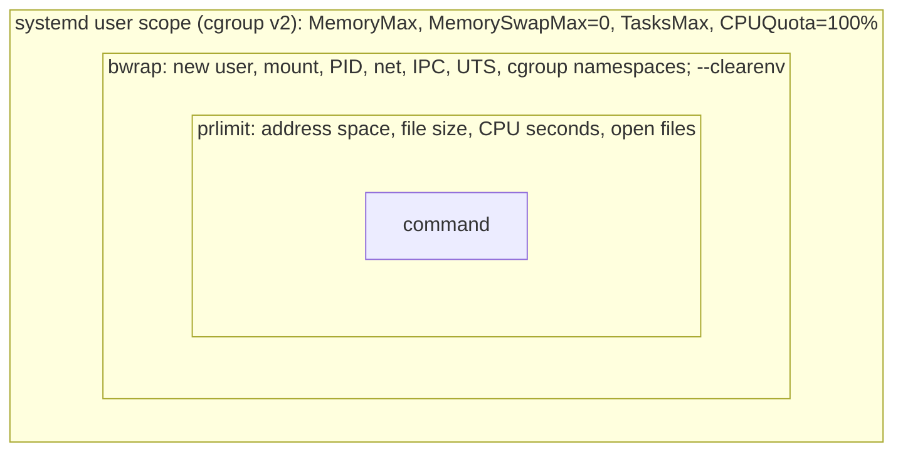

# Architecture

Nullroom runs one *case*: a spec moves from Room A to Room B through a wall,
Room B's source is judged by an oracle, and every step is recorded in a hash
chain. This document describes the components, the data flow, and how each
isolation layer is built. Every guarantee listed here has a test; the test
names are given so you can check them.

## Components

| Module | Responsibility |
| --- | --- |
| `src/abi.ts` | Grammar for the `nullroom-abi` block; generates C prototypes. |
| `src/wall.ts` | Decides whether a spec may cross: prose plus one ABI block, no code-shaped content. |
| `src/audit.ts` | Append-only SHA-256 chain; verification of chain and inbox. |
| `src/sandbox.ts` | `jail()` and `BwrapRunner`: namespaces, per-process and per-jail limits. |
| `src/oracle.ts` | ABI check and output comparison, all inside jails. |
| `src/pipeline.ts` | Orchestrates one case and writes `report.json`. |
| `src/fsutil.ts` | Atomic writes; reading files a room wrote without following symlinks. |
| `src/cli.ts` | `pipeline` and `verify` commands. |

## Data flow



A case directory looks like this:

```
work/<case>/
  target/            original library (Room A: read-only)
  a/outbox/          Room A output (SPEC.md)
  inbox/             what crossed the wall (Room B: read-only)
  b/workspace/       Room B output (reconstructed.c)
  oracle/            snapshots, build output, abi.h
  audit_chain.json
  report.json
```

## Isolation layers

Every command a room or the oracle runs goes through `jail()`. Layers, from
outside in:



| Layer | What it bounds | Test |
| --- | --- | --- |
| Mount namespace | Only `/usr`, two `/etc` files, `/proc`, `/dev`, a private `/tmp`, and the mounts the caller lists. No `/home`. | `room B cannot see the binary at any path (ENOENT)` |
| Network namespace | Loopback only. | `rooms have no network and no home directory leaks` |
| PID namespace | The jail sees only its own processes. | `jail has a private PID namespace` |
| Environment | Empty except `PATH`, `HOME` and what the caller passes. | `oracle jail: no host environment, no /home, only one library` |
| prlimit | Per process: memory, file size, CPU, open files. | `jail limits address space`, `… output file size`, `… open files` |
| cgroup scope | Whole jail: memory and number of tasks, across all processes. | `jail memory limit holds across processes`, `jail limits the number of tasks` |
| Timeout | Wall-clock bound; nothing survives it. | `jail timeout leaves no child process` |
| Writable storage | Every writable mount and `/tmp` is a tmpfs of `storageBytes`. Host content is copied in at start; at the end all processes are stopped and the mounts are exported as one tar on fd 3 into a private host file. The host accepts only regular files and directories inside the mounts, stages them, and swaps them in with `rename`. | `jail bounds total writable storage, with a larger-limit control`, `jail refuses a symlink export and leaves the host directory unchanged` |

`jail()` refuses to run when the cgroup scope cannot be created or when
`/proc/sys/kernel/yama/ptrace_scope` is missing or below 1, instead of running
with fewer protections.

Export descriptor, measured behaviour: the export is written to a private host
file whose descriptor is passed to the jail. Same-uid code in the jail can
reopen and overwrite that file through `/proc/<wrapper>/fd/<n>` during the
command — `ptrace_scope` does not change this, it only governs `ptrace`. This
is harmless because the trusted wrapper regenerates the archive *after* it has
killed every other process in the jail (`kill -9 -1`), so any in-command
tampering is overwritten, and the host still validates the archive before it
imports anything. Test: `in-command tampering with the export file is
overwritten by the trusted wrapper`.

Defence in depth: `jail()` also refuses to run when Yama `ptrace_scope` is
missing or below 1, so a jailed process cannot `ptrace`-attach to the wrapper
(its parent, a non-descendant under `ptrace_scope >= 1`) to interfere with the
kill-then-export sequence itself.

## The wall

A spec is Markdown prose plus exactly one fenced `nullroom-abi` block. The ABI
block must match a small grammar (`handle`, `fn name(params) -> ret`, scalar
types, `in`/`len` and `out`/`cap` buffer pairs, handles). Every line, ABI lines
included, is checked against content rules: hex literals and runs, byte dumps,
register names, instructions with operands, decompiler labels and identifiers,
tool references, and code-shaped lines. Foreign code fences are rejected.

The pipeline reads `SPEC.md` once, refuses symlinks and non-regular files,
scans those bytes, and writes exactly those bytes to the inbox. There is no
second read between check and copy.

## Audit chain

Each entry is `{seq, ts, kind, data, prev, hash}` where
`hash = sha256(canonical_json({seq, ts, kind, data, prev}))` and `prev` is the
previous entry's hash (64 zeros for genesis). Kinds: `genesis`, `room-run`,
`crossing`, `rejected`, `oracle`.

`verifyChain` recomputes every hash, checks the links and sequence numbers,
and compares each inbox file with the hash recorded when it crossed.

The chain shows consistency, not authorship. For runs on `main`, CI signs
`report.json` and `audit_chain.json` with Sigstore build provenance; see
[ADR 0001](adr/0001-audit-provenance.md) for why there is no local signing key.

## Oracle

The oracle never runs Room B's code on the host.

1. Snapshot `reconstructed.c` into `oracle/input/` (no symlinks, size-capped).
2. Compile jail: `gcc -fsyntax-only -Werror -include abi.h` against prototypes
   generated from the wall-approved spec. Errors are reduced to file, line and
   message.
3. Compile jail: build the rebuilt library and the fixed test driver.
4. Two run jails, each with the driver and exactly one library: the original
   or the rebuild. Both print one JSON object; the oracle diffs them key by
   key and maps keys to functions for `report.json`.

The driver (`targets/smoke/smoke_check.c`) uses fixed examples and fixed edge
values. It finds what it exercises and nothing more.

## CI

`.github/workflows/ci.yml` on `ubuntu-24.04`: installs bubblewrap, enables
unprivileged user namespaces, starts a systemd user manager (for cgroup
scopes), then runs typecheck, `npm audit`, the smoke build, all tests, the
pipeline and chain verification. On `main` it attests the report and chain.
Actions are pinned to commit SHAs; the default token is read-only.
`main` is protected: pull request, passing `test` check, branch up to date,
no force-push, no deletion, rules apply to admins.

## Extension points

- `RoomRunner` is the interface a room uses to run commands. `BwrapRunner` is
  the only implementation.
- The ABI grammar and the wall rules are data-driven tables in their modules.
- The oracle takes the driver path as input; another target needs its own
  driver.
